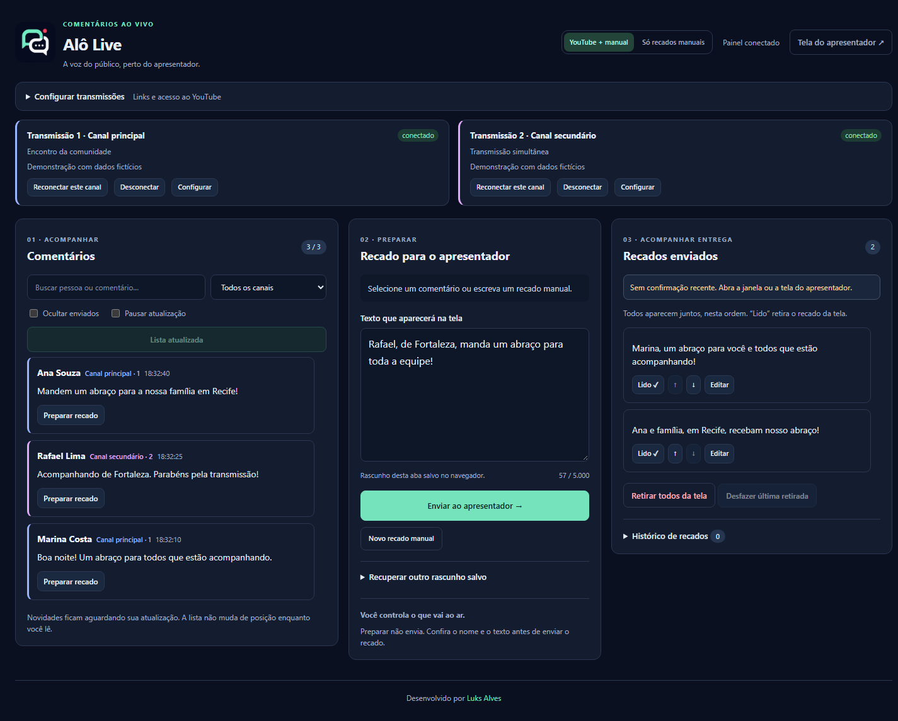
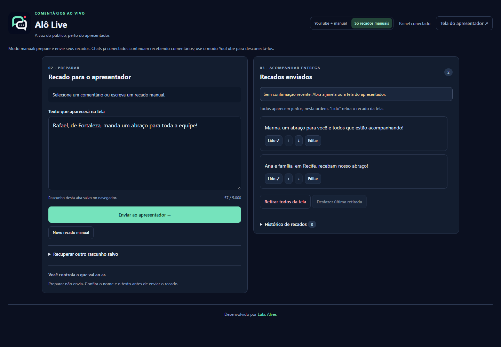
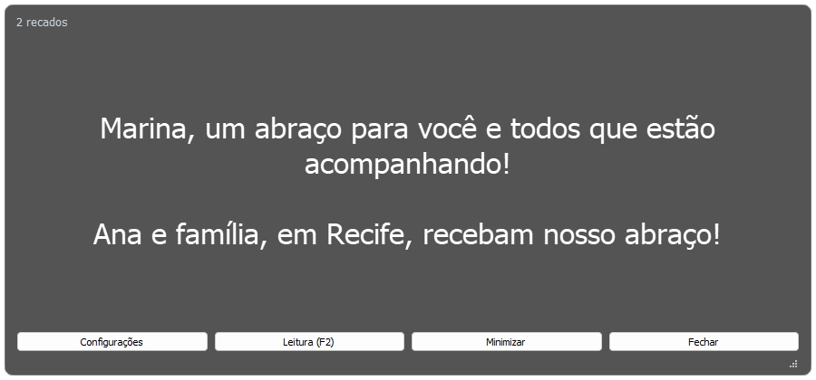

<div align="center">


# Alô Live

### A audiência participa. A produção organiza. O apresentador acompanha.

Reúna os comentários de duas transmissões do YouTube, prepare os recados e entregue os textos em uma janela transparente para o apresentador.


[](LICENSE)

[Motivação](#por-que-desenvolvi) · [Interface](#interface) · [Funcionalidades](#funcionalidades) · [Executar localmente](#executar-localmente) · [Arquitetura](#arquitetura) · [Testes](#testes-e-qualidade)

</div>



## Sobre o projeto

O Alô Live é uma ferramenta de apoio à produção de transmissões ao vivo. Ele organiza a participação do público em três etapas: **acompanhar os comentários, preparar os recados e acompanhar a entrega ao apresentador**.

A produção seleciona um comentário, ajusta o texto e decide quando enviá-lo. O apresentador recebe todos os recados em uma janela sobreposta, com fonte, cor e opacidade ajustáveis. Também é possível trabalhar apenas com recados manuais, sem conectar uma conta ou chave de API.

### Por que desenvolvi

Desenvolvi o Alô Live para atender a uma necessidade do meu trabalho, onde realizamos transmissões ao vivo em dias específicos. Durante a apresentação, o apresentador não tem acesso ao computador: ele conta apenas com a **tela de retorno**. Antes do projeto, precisava consultar o celular nos intervalos para verificar os comentários e as perguntas do público.

A proposta foi levar essas participações diretamente à tela de retorno. Pelo painel, a produção seleciona os comentários, perguntas e mensagens relevantes e envia os textos para o apresentador acompanhar durante a transmissão. O objetivo é facilitar a interação com o público e reunir as informações de que ele precisa na tela que já utiliza.

O suporte a **duas transmissões do YouTube** também nasceu dessa rotina: no meu trabalho, a mesma transmissão acontece em dois canais ao mesmo tempo. Por isso, o painel permite reunir os comentários dos dois chats e selecionar os recados em um só lugar.

O Alô Live começou como um teleprompter e evoluiu a partir do uso durante transmissões. Os arquivos de entrada `Teleprompter.py` e `janela.py` foram preservados para manter a forma de abertura existente.

## Funcionalidades

| Área | Recursos |
| :--- | :--- |
| Comentários | Até dois chats do YouTube, identificação do canal, busca, filtros e novidades sob controle do operador. |
| Preparação | Seleção do comentário, revisão do texto, entrada manual e rascunhos independentes por aba. |
| Fila | Edição, reordenação, marcação como lido, histórico e desfazer da última retirada ou limpeza. |
| Entrega | Confirmação da versão recebida, identificação de tela minimizada e aviso de recados fora da área visível. |
| Apresentação | Janela transparente sempre por cima, redimensionamento, rolagem, modo de leitura e preferências salvas. |
| Recuperação | Gravação atômica, 20 backups locais e recuperação automática de uma cópia válida. |
| Inicialização | Abertura do servidor, navegador e janela com dois cliques; controle dos processos pelo inicializador. |

**Todos os recados aparecem juntos**, na ordem definida pela produção. A confirmação de entrega informa que a interface recebeu os textos; ela não confirma que a pessoa os leu.

## Interface

As capturas mostram a aplicação real com **nomes, recados e canais fictícios**. O YouTube foi simulado para a documentação; nenhuma captura utiliza credenciais ou comentários de uma transmissão real.

<details>
<summary>Operação apenas com recados manuais</summary>



</details>

<details>
<summary>Janela do apresentador</summary>



</details>

A janela possui fundo translúcido durante o uso. A captura isolada pode apresentar esse fundo como preto. Veja [como reproduzir as imagens](docs/SCREENSHOTS.md).

## Como usar

1. Abra **Iniciar.pyw**. O inicializador abre o painel e a janela do apresentador.
2. Escolha **Só recados manuais** ou configure os links dos vídeos ao vivo e a chave da YouTube Data API v3.
3. Escreva um recado ou clique em **Preparar recado** em um comentário. Revise o nome e o texto.
4. Clique em **Enviar ao apresentador** e acompanhe a confirmação na fila.
5. Marque como **Lido** para retirar o texto. Os demais recados ocupam o espaço disponível; o histórico permite restaurar retiradas.
6. Ao terminar, use **Encerrar sistema** no inicializador. Ele encerra os processos que iniciou.

Na janela, clique com o **botão direito** para acessar as configurações. **F2** mostra ou esconde os controles. O [guia de uso](docs/GUIA_DE_USO.md) detalha os atalhos, conexões, rascunhos e recuperação.

## Executar localmente

Requisitos: **Windows x64, Python 3.13 e navegador moderno**, ambiente utilizado na validação. Internet é necessária para instalar dependências e, opcionalmente, acompanhar o YouTube.

Clone o repositório e entre na pasta do projeto:

```powershell
git clone https://github.com/xLuuks/alo-live.git
cd alo-live
```

Instale as dependências em um ambiente virtual:

```powershell
python -m venv .venv
.\.venv\Scripts\python.exe -m pip install --upgrade pip
.\.venv\Scripts\python.exe -m pip install -r requirements-lock.txt
```

Depois, abra **Iniciar.pyw** com dois cliques. Ele utiliza a instalação de `.venv` quando disponível. Mantenha o inicializador aberto durante o uso. Também é possível executar:

```powershell
.\.venv\Scripts\python.exe inicializador.py
```

| Endereço local | Uso |
| :--- | :--- |
| `http://127.0.0.1:5000/editor` | Painel da produção. |
| `http://127.0.0.1:5000/teleprompter` | Alternativa de apresentação no navegador. |

O modo manual funciona sem chave. Para o YouTube, [configure a API e as transmissões](docs/GUIA_DE_USO.md#conectar-o-youtube). A chave é informada no painel ou por variável de ambiente; ela não é incluída no código.

`requirements.txt` declara as dependências diretas. `requirements-lock.txt` fixa também as dependências transitivas do ambiente Windows validado. Não é necessário ativar o ambiente virtual para executar os comandos acima.

## Arquitetura

| Tecnologia | Responsabilidade |
| :--- | :--- |
| Python + Flask | API local, validação dos comandos e coordenação da fila. |
| HTML, CSS e JavaScript | Painel responsivo, rascunhos e atualização incremental dos cartões. |
| PyQt5 + Qt Network | Janela transparente e consultas assíncronas sem bloquear a interface. |
| YouTube Data API v3 + requests | Coletores independentes para duas transmissões. |
| JSON + gravação atômica | Persistência da fila, histórico, versões e última retirada. |
| unittest + navegador via CDP | Regressão de API, persistência, janela e fluxos de operação. |

```text
Chats do YouTube / recado manual
    -> preparação e revisão pela produção
    -> fila local persistida
    -> janela ou navegador do apresentador
    -> confirmação de recebimento e estado da rolagem
    -> marcação como lido, histórico e restauração
```

### Estrutura

```text
Iniciar.pyw               # Entrada com dois cliques
inicializador.py          # Interface para abrir e encerrar o sistema
sistema.py / processos.py # Ciclo de vida dos processos iniciados
Teleprompter.py           # Rotas e proteções do servidor local
youtube_chat.py           # Coleta e reconexão dos chats
recados.py                # Fila, histórico, idempotência e backups
janela.py / instancia.py  # Janela, preferências e instância única
registros.py              # Logs com rotação e ocultação de chaves
marca.py / static/brand/  # Nome público e logo compartilhada
templates/ / static/      # Painel e apresentação no navegador
tests/                    # Testes isolados e regressão no navegador
scripts/                  # Capturas e preparação do pacote para GitHub
docs/                     # Guia de uso, detalhes técnicos e screenshots
.github/                  # Workflow de verificações e Dependabot
```

### Decisões de engenharia

- **Operação explícita:** comentários novos aguardam a atualização da lista; selecionar um comentário não o envia automaticamente.
- **Identidade estável:** ações usam IDs, e cartões existentes são preservados durante as atualizações da fila.
- **Envio recuperável:** tentativas com o mesmo identificador, texto e origem reconhecem o envio já salvo, sem criar outra cópia.
- **Persistência consistente:** a memória é atualizada depois da gravação atômica; uma falha somente no backup não desfaz o envio já salvo.
- **Confirmação separada:** salvar no servidor e receber na tela do apresentador são estados distintos.
- **Interface assíncrona:** consultas da janela têm tempo limite. O último texto permanece disponível durante uma desconexão.

Os limites de retenção, a cota da API e os detalhes da implementação estão no [guia técnico](docs/TECNICO.md).

## Testes e qualidade

```powershell
.\.venv\Scripts\python.exe -m pip install -r requirements-dev.txt
.\.venv\Scripts\python.exe -m pip check
.\.venv\Scripts\python.exe -B -m unittest discover -s tests -v
```

Os testes usam arquivos temporários e respostas simuladas. Cobrem falhas de gravação, restauração ordenada, reenvio após resposta perdida, confirmação de rolagem, proteção das rotas, ajustes da janela e ciclo de vida do inicializador.

Com Chrome ou Edge instalado:

```powershell
.\.venv\Scripts\python.exe -B tests/browser_smoke.py
.\.venv\Scripts\python.exe -B tests/browser_smoke.py --manual-only
.\.venv\Scripts\python.exe -B tests/browser_smoke.py --refinements
.\.venv\Scripts\python.exe -B tests/browser_smoke.py --delivery-refinements
.\.venv\Scripts\python.exe -m pip_audit -r requirements-lock.txt
```

O navegador utiliza um perfil temporário separado. Os testes não abrem suas abas habituais nem consultam o YouTube. O workflow de CI está preparado para executar essas verificações no GitHub; a validação local não substitui a primeira execução remota.

## Privacidade e publicação

O servidor atende somente o próprio computador, em `127.0.0.1`, com depuração desligada, validação do host, proteção CSRF e limite de tamanho das requisições. Textos são exibidos como texto simples.

Fila, histórico, backups, logs e rascunhos ficam localmente. **Os dados locais não são criptografados.** O YouTube é um serviço externo: conectar um chat realiza consultas autenticadas à API do Google.

O `.gitignore` exclui dados de operação, ambientes virtuais, logs, backups e arquivos comuns de credenciais. O [guia de publicação](docs/PUBLICACAO.md) explica a revisão antes do envio e a geração de um ZIP com os arquivos do projeto. Consulte também a [política de segurança](SECURITY.md).

**Este aplicativo não é hospedável no GitHub Pages.** O GitHub pode armazenar o código e executar os testes; a aplicação depende do servidor Python e da janela desktop no computador do operador.

## Limitações

- Até duas transmissões do YouTube com chat ativo; Facebook não está implementado.
- Nenhuma resposta é publicada nos chats: os recados são destinados à tela do apresentador.
- A coleta usa consultas periódicas e respeita o intervalo mínimo retornado pela API. O padrão é 30 segundos.
- Até 1.000 comentários ficam em memória; reiniciar o servidor limpa esse buffer. Recados enviados e histórico são persistidos.
- Os últimos 200 recados retirados ficam no histórico. O desfazer mantém a última retirada inteira, mesmo acima desse limite.
- Os 20 backups são locais e não protegem contra perda do disco ou da pasta inteira.
- Uma única instância do servidor deve coordenar a fila. Não há autenticação para acesso em rede nem suporte à publicação do painel na internet.
- A validação automatizada do YouTube usa simulações; o teste com duas transmissões reais exige chave e chats ativos.
- Outras plataformas e versões de Python não fazem parte do ambiente validado nesta documentação.

## Autor e licença

Desenvolvido por **[Luks Alves](https://github.com/xLuuks)** como projeto de portfólio, com foco na operação de transmissões ao vivo, persistência local e evolução a partir do uso real.

A identidade visual utiliza dois balões de conversa e um ponto vermelho de transmissão. A [documentação da marca](docs/MARCA.md) reúne o arquivo e a origem da logo.

Distribuído sob a [GNU GPL versão 3](LICENSE), com copyright de 2026 de Luks Alves. As bibliotecas mantêm suas próprias licenças; veja [as dependências](docs/DEPENDENCIAS.md).

Outros projetos: [Local Transcriber](https://github.com/xLuuks/local-transcriber) · [Local Scanner](https://github.com/xLuuks/local-scanner) · [IBN Acadêmico](https://github.com/xLuuks/ibn-academico-portfolio).
